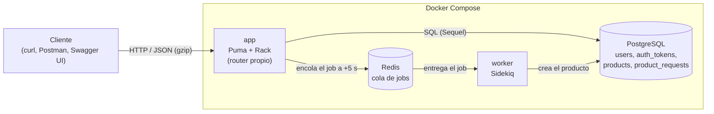
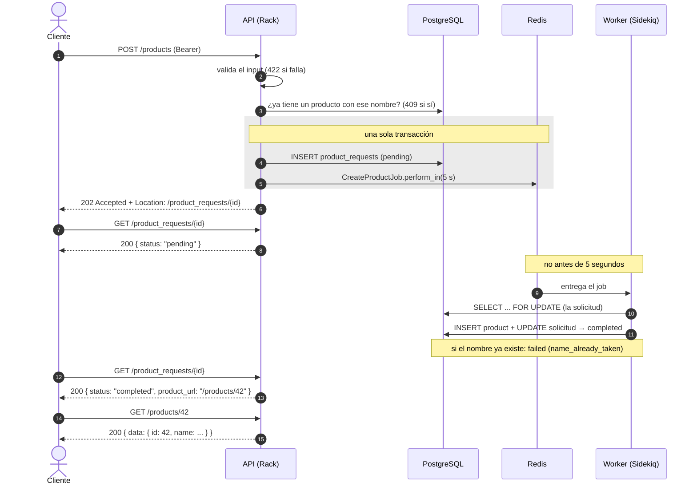

# Fudo Challenge: API de productos

## 1. Descripción

API REST en Ruby para el desafío técnico de **Fudo (Backend Payments)**, hecha sobre **Rack puro** (sin Rails ni Sinatra):

- **Login** con usuario y contraseña (guardada con bcrypt) y token Bearer que vence a las 24 horas y se puede revocar.
- **Creación de productos asíncrona:** la API responde `202` y el producto lo crea un job de **Sidekiq**, que corre no antes de 5 segundos después.
- **Consulta de productos:** cada usuario ve solo los suyos, paginados.
- Un usuario **no puede tener dos productos con el mismo nombre** (sin distinguir mayúsculas).
- **`GET /AUTHORS`:** archivo estático con caché de 24 horas.
- Respuestas comprimidas con **gzip** cuando el cliente lo pide.
- Documentada con OpenAPI (Swagger UI) y probada con RSpec y con una colección de Postman que Newman corre en el CI.

## 2. Arquitectura



Dentro de la app, cada request pasa por una cadena de middlewares Rack y termina en un handler:

```
Rack::Head → RequestId → RequestLogger → Rack::Deflater → ErrorHandler → Router → handler → servicio → modelo
```

### Creación asíncrona de un producto



- La respuesta del `POST` **no confirma** que el producto exista: solo dice que la solicitud quedó registrada.
- El producto aparece **no antes de 5 segundos** después, y en la práctica entre 5 y 6,5 segundos, porque Sidekiq revisa los jobs programados más o menos cada segundo. Justo después de reiniciar el worker, Sidekiq espera de 10 a 15 segundos antes de su primera revisión.
- Si dos pedidos con el mismo nombre llegan casi a la vez, los dos reciben `202`: el índice único de la base deja pasar uno solo y el otro termina `failed`.
- El job es **idempotente**: si corre dos veces, incluso al mismo tiempo, crea un solo producto. Se reintenta hasta 5 veces ante errores inesperados, y al arrancar el worker re-encola las solicitudes que quedaron `pending`.

## 3. Requisitos

Solo **Docker** con **Docker Compose v2**. No hace falta instalar Ruby, PostgreSQL ni Redis.

| Servicio | Qué es | Puerto en tu máquina |
|---|---|---|
| `app` | La API (Ruby 4.0 + Rack + Puma) | `9292` |
| `worker` | Sidekiq, que crea los productos | — |
| `db` | PostgreSQL 18 | `5433` (para no chocar con un PostgreSQL local) |
| `redis` | Redis 8 | — |
| `swagger-ui` | Documentación interactiva | `8081` |

## 4. Cómo levantarlo

```bash
git clone https://github.com/guidogg01/fudo-challenge.git
cd fudo-challenge
docker compose up -d --build
docker compose exec app bundle exec rake db:seed
```

- La primera vez tarda alrededor de un minuto, mientras construye la imagen.
- La app aplica las migraciones sola al arrancar.
- El seed crea el usuario de prueba y se puede correr más de una vez sin duplicarlo.

Para ver que todo esté sano, `docker compose ps` o:

```bash
curl http://localhost:9292/health
# {"status":"ok","checks":{"database":"ok","redis":"ok"}}
```

Para apagar: `docker compose down`. Con `docker compose down -v` se borran también los datos.

**Configuración.** Todas las variables tienen un valor por defecto que funciona con Docker Compose. Para cambiar alguna, copiá [`.env.example`](.env.example) a `.env`. Las variables son `DATABASE_URL`, `TEST_DATABASE_URL`, `REDIS_URL`, `RACK_ENV`, `PORT`, `PUMA_MAX_THREADS`, `BCRYPT_COST` (12), `TOKEN_TTL_SECONDS` (86400) y `LOG_LEVEL` (info).

## 5. Cómo probarlo

### Usuario demo

`demo` / `demo1234`, creado por `rake db:seed`. No hay endpoint de registro, porque el enunciado no lo pide.

### Con curl

```bash
API=http://localhost:9292

# Login: devuelve el token (se guarda en la variable TOKEN)
TOKEN=$(curl -s -X POST $API/auth/login -H 'Content-Type: application/json' \
  -d '{"username":"demo","password":"demo1234"}' | sed -E 's/.*"token":"([^"]+)".*/\1/')

# Pedir la creación de un producto: 202 y el header Location con la URL de la solicitud
curl -i -X POST $API/products -H "Authorization: Bearer $TOKEN" -H 'Content-Type: application/json' \
  -d '{"name":"Mesa de roble","description":"Para 4 personas","price_cents":150000,"quantity":3}'

# Consultar la solicitud: "pending" y, unos 5 segundos después, "completed" con product_url
curl $API/product_requests/<id-de-la-solicitud> -H "Authorization: Bearer $TOKEN"

# Listar mis productos (paginado), pidiendo la respuesta comprimida con gzip
curl -i --compressed "$API/products?page=1&per_page=20" -H "Authorization: Bearer $TOKEN"
# → content-encoding: gzip

# Ver un producto
curl $API/products/<id-del-producto> -H "Authorization: Bearer $TOKEN"

# AUTHORS: público, cacheable 24 horas
curl -i $API/AUTHORS
# → cache-control: public, max-age=86400
# → last-modified: ...
# Con el Last-Modified que devolvió, responde 304 sin cuerpo:
curl -i $API/AUTHORS -H 'If-Modified-Since: <last-modified>'

# Estado de la app y sus dependencias
curl $API/health

# Logout: revoca el token (después, ese token da 401)
curl -i -X POST $API/auth/logout -H "Authorization: Bearer $TOKEN"
```

### Con Swagger UI

Abrí <http://localhost:8081>. Ahí está toda la API, con ejemplos de cada respuesta y de cada error. Para probar desde el navegador: corré `POST /auth/login` con "Try it out", copiá el token en **Authorize** y probá el resto. El contrato está en [`docs/openapi.yaml`](docs/openapi.yaml).

### Con Postman

En [`postman/`](postman/) están la colección (30 requests, cada uno con sus tests) y el environment local. Importá los dos, elegí el environment "Fudo Challenge - Local" y corré la colección con **Run collection**. Las carpetas están en el orden del flujo: estado y AUTHORS, login, creación, espera de la solicitud, consultas y errores, y logout.

### Con Newman (la misma colección, desde la terminal)

```bash
docker run --rm --network fudo-challenge_default -v "$(pwd)/postman:/etc/newman" node:22-alpine \
  npx -y newman@6.2.2 run /etc/newman/fudo-challenge.postman_collection.json \
  -e /etc/newman/local.postman_environment.json --env-var base_url=http://app:9292
```

### Tests y linter

```bash
docker compose exec app bundle exec rspec     # tests, contra su propia base (fudo-challenge-test)
docker compose exec app bundle exec rubocop   # estilo y buenas prácticas
```

El [CI](.github/workflows/ci.yml) corre en cada push a `main` y en cada pull request, con dos jobs. `test` corre RuboCop y RSpec. `newman` levanta el stack completo con Docker Compose y corre la colección de Postman.

## 6. Endpoints

| Método | Ruta | Auth | Respuesta |
|---|---|---|---|
| `POST` | `/auth/login` | — | `200` con el token Bearer (vence a las 24 h). |
| `POST` | `/auth/logout` | Bearer | `204`. Revoca el token. |
| `POST` | `/products` | Bearer | `202` con la solicitud `pending` y `Location: /product_requests/{id}`. |
| `GET` | `/product_requests/{id}` | Bearer | `200` con `pending`, `completed` (más `product_url`) o `failed` (más el motivo). |
| `GET` | `/products` | Bearer | `200` con mis productos (`page`, `per_page` hasta 100, orden por `id`) y `meta`. |
| `GET` | `/products/{id}` | Bearer | `200` con uno de mis productos. |
| `GET` | `/AUTHORS` | — | `200` con texto plano, `Cache-Control: public, max-age=86400`, `Last-Modified` y `304`. |
| `GET` | `/health` | — | `200` si responden PostgreSQL y Redis, `503` si no. |

- Un recurso de **otro usuario** responde `404`, igual que uno que no existe.
- Todas las respuestas traen `X-Request-Id`, y aceptan gzip y `HEAD`.
- El producto tiene `id`, `name` (1 a 100 caracteres), `description` (opcional, hasta 500), `price_cents` (entero en centavos) y `quantity`.
- Los errores siempre tienen el mismo formato: `{ "error": { "code", "message", "details" } }`. `code` es un identificador estable en inglés y `message` un texto en español. Los status posibles son `400`, `401`, `404`, `405`, `409`, `413`, `415`, `422` y `500`. El detalle de cada uno está en Swagger UI.

## 7. Decisiones principales

El **por qué** de cada una, con las alternativas descartadas, está en [`DECISIONS.md`](DECISIONS.md). Las más importantes:

- **Rack puro con un router propio.** El enunciado prohíbe los frameworks web, y cada ruta declara si es pública.
- **Tokens opacos** (se guarda solo su SHA-256) en lugar de JWT, para poder revocarlos al instante.
- **Creación asíncrona** con una tabla de solicitudes y `perform_in(5)`, nunca con `sleep`. El cliente sigue el estado en `/product_requests/{id}`.
- **Job idempotente** con `SELECT ... FOR UPDATE`, y reintentos acotados.
- **La unicidad del nombre la garantiza la base**, con un índice único sobre `(user_id, lower(name))`. El 409 temprano es solo un aviso.
- **Dinero en centavos enteros**, nunca float.
- **404 en lugar de 403** para recursos ajenos.
- **Ningún input del cliente termina en 500:** JSON roto, UTF-8 inválido, cuerpos grandes e ids imposibles responden 400, 404, 413 o 422.
- **Logs JSON** con `X-Request-Id`, que se propaga hasta el job.

## 8. Librerías usadas

| Librería | Para qué | Por qué |
|---|---|---|
| `rack` | Interfaz entre el servidor y la app, y middlewares (`Deflater`, `Files`, `Head`) | Es la base que pide el enunciado. |
| `puma` | Servidor HTTP | Multi-thread y el estándar en Ruby. |
| `sequel` + `pg` | Acceso a PostgreSQL y migraciones | ORM liviano, consultas parametrizadas, sin arrastrar Rails. |
| `bcrypt` | Hash de contraseñas | Lento a propósito: resiste fuerza bruta. |
| `sidekiq` | Cola de jobs (sobre Redis) | El estándar en Ruby, con `perform_in` y reintentos. |
| `rake` | Tareas de base (`db:migrate`, `db:seed`) | Simple, y viene con Ruby. |
| `rspec` + `rack-test` | Tests | Prueban la app Rack real, sin levantar un servidor. |
| `rubocop` + `rubocop-rspec` | Linter | Estilo consistente y detección de errores comunes. |

## 9. Cómo usé IA

Utilicé un asistente de IA principalmente como **herramienta de análisis**, dentro de un proceso de trabajo definido de antemano y bajo mi supervisión en cada paso.

**Uso como herramienta de análisis.** La mayor parte del uso estuvo orientada a:

- **Interpretar el enunciado:** descomponerlo en requisitos verificables, identificar ambigüedades (por ejemplo, qué significa que el producto esté disponible "5 segundos después" o cómo tratar dos solicitudes simultáneas con el mismo nombre) y armar una lista de trazabilidad entre requisito y prueba.
- **Evaluar alternativas de diseño:** comparar opciones con sus ventajas y desventajas antes de decidir (JWT frente a tokens opacos, distintas colas de trabajos, estrategias de idempotencia, paginación). Cada decisión quedó registrada, con las alternativas descartadas, en [`DECISIONS.md`](DECISIONS.md).
- **Analizar riesgos y casos borde:** condiciones de carrera, fallas a mitad de camino, entradas inválidas que podían terminar en errores 500 y limitaciones de las librerías, que se verificaron en su código fuente.
- **Revisar el código:** al cerrar cada bloque se realizó una revisión independiente, enfocada en errores, seguridad y consistencia. Sus hallazgos se analizaron antes de aplicar cualquier cambio.

**Proceso y control.**

- También asistió en la implementación, que revisé y validé paso a paso.
- El trabajo se organizó por etapas (análisis, diseño, implementación incremental, pruebas, documentación y revisión final), con un punto de control al cierre de cada una. Ningún cambio se incorporó al repositorio sin mi aprobación explícita.
- La corrección del sistema no se dio por supuesta: se verificó con la suite de RSpec, la colección de Postman ejecutada con Newman, pruebas de punta a punta sobre un clon limpio del repositorio y el CI.

## 10. Por qué no hice una skill ni un orquestador

Este es un proyecto de una sola vez, con un alcance acotado. Armar una skill reutilizable o un orquestador de agentes habría sido sobre-ingeniería: más tiempo en la herramienta que en el problema, y más piezas para explicar sin un beneficio real para este caso. Preferí un proceso simple y explícito (etapas, gates y revisiones), que se puede seguir y defender línea por línea.

## 11. Próximos pasos

- **Rate limiting** en el login y en la creación de productos.
- **`Idempotency-Key` en `POST /products`**, para que un cliente pueda reintentar sin crear dos solicitudes.
- **Paginación por cursor** (`?after=42`), más eficiente que el offset en tablas grandes.
- **Moneda:** hoy se asume una sola.
- **Refresh tokens**, para no tener que volver a hacer login cada 24 horas.
- **Observabilidad:** enviar los logs a OpenSearch, tablero en Grafana y tracing con OpenTelemetry.
- **Métricas:** latencia por endpoint, tamaño de la cola y tiempo de creación de productos.
- **Borrar los tokens vencidos o revocados** con una tarea periódica.
- Algunas limitaciones conocidas, documentadas en `DECISIONS.md`:
  - un worker que se cae de golpe pierde el job en curso (hay una red de seguridad al arrancar, y el patrón *transactional outbox* lo resolvería del todo);
  - si la base está caída durante todos los reintentos, la solicitud queda `pending` hasta reiniciar el worker;
  - `/health` combina *liveness* y *readiness*.

## Autor

Guido Greco
